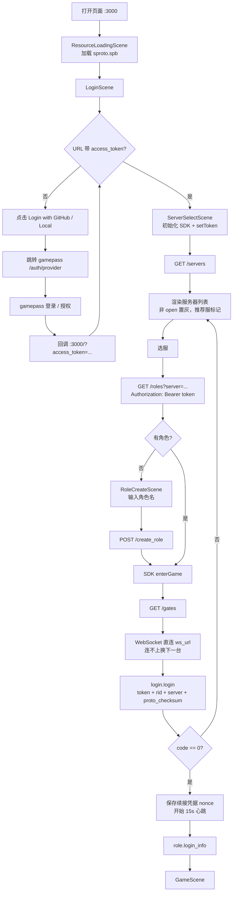
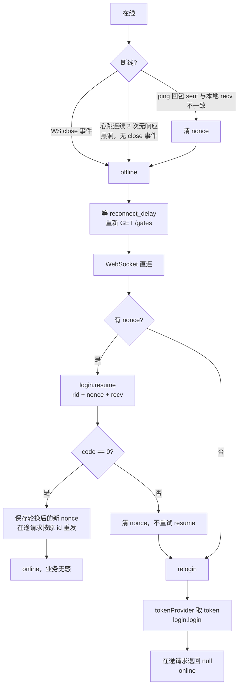
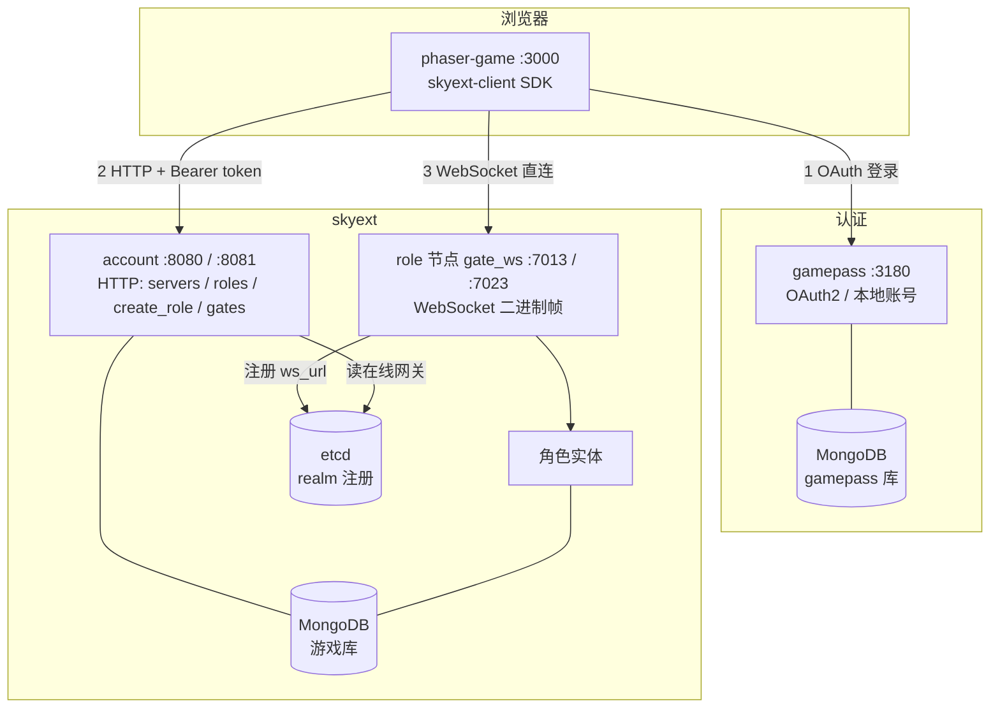
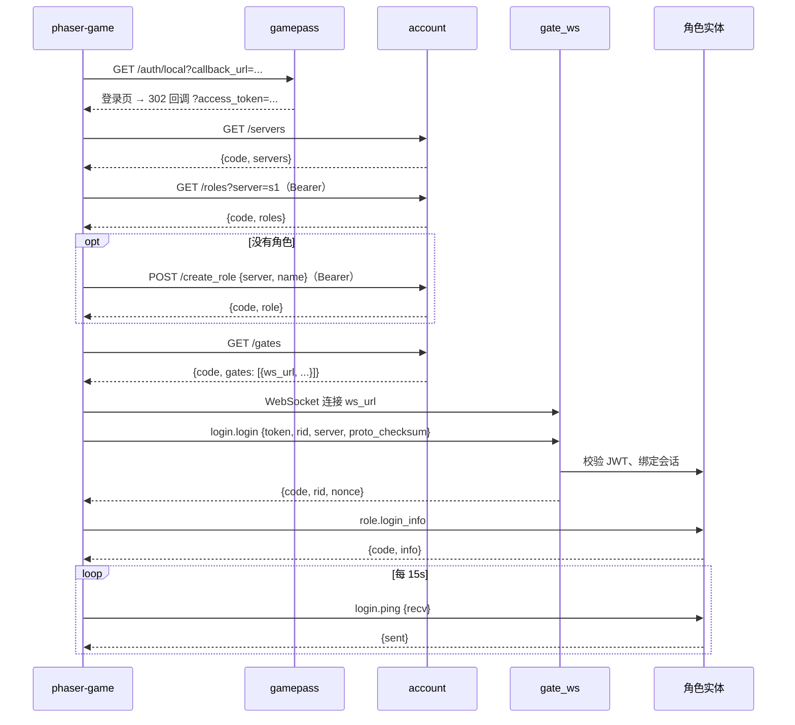
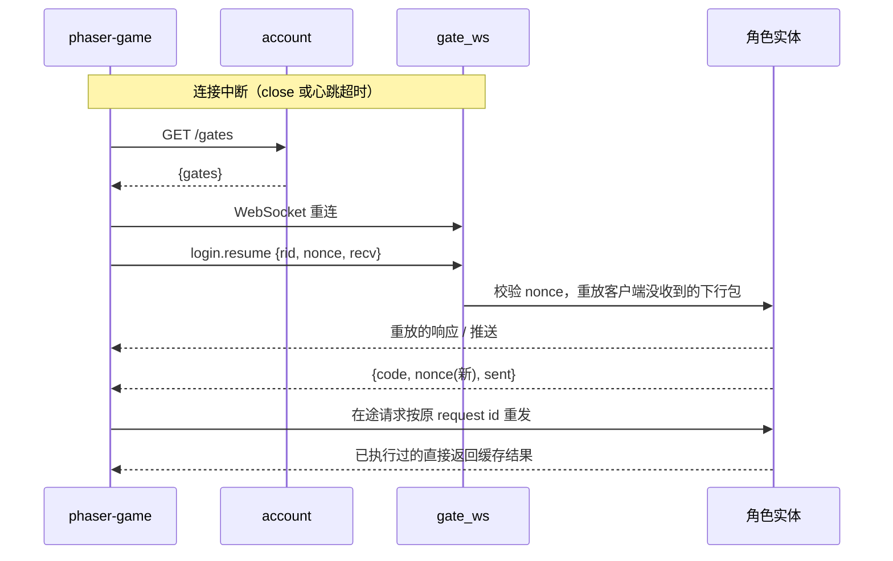

# 登录流程图

文字说明见 [登录流程](doc.md)。

## 概述

- **浏览器客户端（本项目）**：gamepass OAuth 拿 token → account HTTP 选服/查角色/建角 → `GET /gates` 发现网关 → WebSocket 直连 gate_ws → `login.login`。网络层用 skyext 官方 TS SDK（`skyext-client`）。
- **机器人客户端（skyext `./bin/skyext serve robot`）**：用 `/dev_login` 签 token（仅开发环境），其余流程相同，网络层用 skyext 的 Lua SDK（`sdk/lua`），在 TCP 和 WS 两种传输上各跑一遍，含断线续接。

两种客户端的会话层语义相同，都按 skyext `docs/guide/client_protocol.md` 实现。

## 完整登录流程（浏览器客户端）



## 断线续接流程



## 服务架构图



客户端和网关之间没有代理。网关地址由 role 节点注册进 realm，account 的 `GET /gates` 只返回真在线的网关，客户端配置里只写 account 地址。

## 协议交互时序图

### 浏览器客户端



### 断线续接



## 关键数据结构

### JWT（gamepass 签发）

```json
{
  "account": "6ad8a4a4a61816e1cee8561c",
  "email": "user@example.com",
  "token_type": "access",
  "exp": 1792600000
}
```

skyext 服务端按 `account` 字段识别账号。验签配置是 skyext 的 `login_jwt_alg` / `login_jwt_secret`（或 RS256/ES256 公钥），必须与 gamepass 的签名配置一致。

### OAuth 回调参数

成功：`http://localhost:3000/?access_token=...&refresh_token=...`

失败：`http://localhost:3000/?error=...&error_description=...`

`OAuthLogin` 读取后立即用 `history.replaceState` 从地址栏清掉。

### 角色信息

```json
{
  "rid": 68665289499577,
  "name": "pgweb063776",
  "server": "s3"
}
```

`rid` 超过 2^53 时 SDK 解成 `bigint`，类型为 `bigint | number`，原样传回 `enterGame` 即可。

### account API

| 接口 | 鉴权 | 请求 | 响应 |
| --- | --- | --- | --- |
| `GET /servers` | 无 | — | `{code, servers: [{server, name, tag, status, open_time, recommended?}]}` |
| `GET /roles?server=s1` | Bearer | — | `{code, roles: [RoleInfo]}` |
| `POST /create_role` | Bearer | `{server, name}` | `{code, role: RoleInfo}` |
| `GET /gates` | 无 | — | `{code, gates: [{node, ws_url, tcp_addr, weight}]}` |

### 客户端配置（`public/serverlist.json`）

```json
{
  "account_hosts": ["http://127.0.0.1:8080", "http://127.0.0.1:8081"]
}
```
